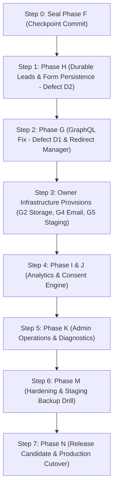

# 15. MASTER COMPLETION PLAN

**Project:** Seven Lands / سفن لاند  
**Target:** Production-Ready Release Candidate (RC)  
**Authoritative Plan:** Approved Onboarding Baseline (2026-10-09)

---

## 1. Executive Strategy

The Seven Lands project possesses a mature, highly refined frontend and a robust Payload CMS 3 / PostgreSQL 17 architecture. The public website's design, responsive behavior, and accessibility are complete and verified. 

**Core Implementation Mandate:**
- DO NOT rewrite or replace the existing Next.js 16 + Payload CMS 3 architecture.
- DO NOT start from scratch or redesign public components.
- Focus strictly on closing critical data gaps, persisting form inquiries, fixing verified defects, and executing the staging-to-production path.

---

## 2. Sequence of Execution & Phase Roadmap

---

## 3. Detailed Work Breakdown by Milestone

### Milestone 1: Baseline Preservation & Lead Protection (IMMEDIATE)
1. **Seal Phase F:**
   - Document Phase F achievements in `docs/admin-control-center/phase-f/PHASE_F_REPORT.md`.
   - Create Git checkpoint commit for Phase F domain content and migrations.
   - *Complexity: LOW*
2. **Implement Phase H (Lead Persistence — Defect D2):**
   - Create `Leads` collection in Payload CMS with permanent V1 workflow statuses: `NEW`, `CONTACTED`, `QUALIFIED`, `WON`, `LOST`, `SPAM`.
   - Strictly enforce submission flow: validate -> spam/rate checks -> durable PostgreSQL Lead persistence -> success response -> secondary email/webhook notifications -> optional WhatsApp continuation. Email/webhook failure must NEVER lose the lead or return false failure if persisted.
   - Create and apply database migration using `npx payload migrate:create` and `npx payload migrate`.
   - Update `src/app/api/brief/route.ts` to write to the `leads` collection via Payload Local API before returning response.
   - Add automated test ensuring form submissions create durable PostgreSQL records.
   - *Complexity: MEDIUM*

### Milestone 2: Technical Defect Resolution & Redirects
1. **Fix Defect D1 (GraphQL Schema Crash):**
   - **Crucial Rule:** Do NOT perform a casual direct rename of `capability:slug` -> `capability_slug`. These values participate in persisted CMS/navigation identities.
   - Preserve route identity and stored meaning; prefer a GraphQL-safe mapping/representation or explicit migration proving navigation/public routes/content equivalence without patching Payload/GraphQL internals. (Do NOT execute in Phase H mandate).
   - Verify `POST /api/graphql` returns HTTP 200 for schema queries.
   - *Complexity: LOW*
2. **Build Redirect Manager (Phase G):**
   - Create `Redirects` collection in Payload CMS (fields: source, destination, permanent/temporary).
   - Wire redirect resolution into `src/proxy.ts` middleware.
   - *Complexity: MEDIUM*

### Milestone 3: Infrastructure & External Provider Integration
1. **Media Storage Adapter (Owner Gate G2):**
   - Implement `@payloadcms/plugin-cloud-storage` or S3/R2 storage adapter.
   - Configure private asset signing and public CDN URL distribution.
   - *Complexity: MEDIUM*
2. **Transactional Email Provider (Owner Gate G4):**
   - Integrate Nodemailer/Resend adapter for Payload CMS.
   - Enable admin password reset delivery and real-time email dispatch on new leads (unconfigured email is non-blocking for lead persistence).
   - *Complexity: LOW*

### Milestone 4: Analytics, Consent & Operations
1. **Phase I & J (Attribution & Consent):**
   - Add GA4 measurement integration in `src/components/system/AnalyticsListener.tsx` gated by client consent state.
   - Add lightweight bilingual cookie consent banner.
   - **Launch Policy:** Analytics/Consent is non-blocking for normal organic launch; however, PAID TRAFFIC / AD CAMPAIGNS must NOT start until analytics + consent + tracking configuration are fully operational.
   - *Complexity: MEDIUM*
2. **Phase K (Admin Operations):**
   - Add search indexing and site health verification endpoint.
   - *Complexity: LOW*

### Milestone 5: Hardening, Staging Drill & Production Launch
1. **Staging Deployment:**
   - Deploy build artifact to private staging environment with managed PostgreSQL.
   - Execute database restore drill from automated backup.
2. **Owner Verification & Real Device Pass:**
   - Physical device verification on iOS Safari and Android Chrome.
   - Final owner review of legal pages (`/privacy`, `/terms`) to authorize search indexing.
3. **Production Cutover (Phase N):**
   - Switch DNS from legacy WordPress installation on Hostinger to the new Seven Lands platform.
   - Verify live SSL, canonical tags, and real-time lead submissions.
   - *Complexity: HIGH (Operational)*

---

## 4. Acceptance Criteria for Release Candidate (RC)
- Zero build, typecheck, or lint warnings.
- 100% of form submissions create durable records in PostgreSQL.
- GraphQL endpoint answers queries without crashing.
- Media uploaded in production resides on persistent cloud object storage.
- All 20 public routes serve correct canonical and hreflang metadata under 200 HTTP response.
- Automated daily backups configured with proven restore capability.
- Owner approval signed off on business data and legal text.
